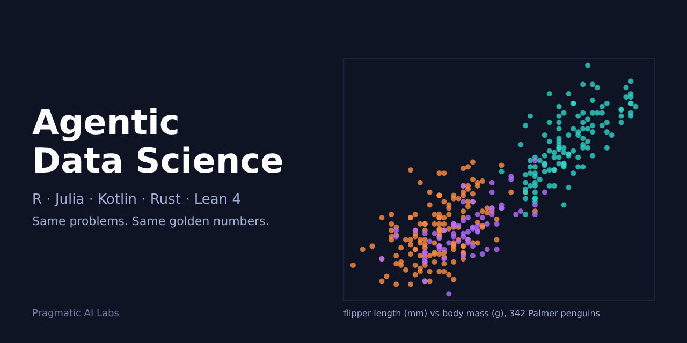

# Agentic Data Science: code examples



Runnable, tested code examples for the **Agentic Data Science** specialization by Pragmatic AI Labs: the same four data science problems solved in five languages with an AI coding agent in the loop, under strict quality gates.

## The five courses

| Course | Language |
|---|---|
| C | R |
| B | Julia |
| D | Kotlin |
| A | Rust |
| E | Lean 4 |

Specialization: https://www.coursera.org/specialization/agentic-data-science (link goes live at launch).

## Layout

- `datasets/`: Palmer Penguins and UCI Wine Quality, each with LICENSE and SHA256SUMS; fixed folds, splits and centroids in `fixtures/`; golden reference numbers in `golden/`.
- `ontology/`: vocabulary and SHACL shapes that every example's `example.ttl` must satisfy.
- Language packages (`r/`, `julia/`, `kotlin/`, `rust/`, `lean/`) are added as each course's examples land.

## Run the gates

```bash
make gate
```


## Format and lint gate

CI jobs for R, Julia and Lean run a format and lint check with zero diff and zero warnings. Line width is 68 in every config. The Kotlin and Rust rows are config only until their first code lands: Kotlin M1 (#23) brings its own gradle job with ktlint and detekt, Rust M1 (#47) its own rust job; each pins its tools in that PR.

| Language | Format | Lint | Pinned by |
|---|---|---|---|
| R | styler (tidyverse style) check | lintr, `line_length_linter(68)` | `scripts/r-pins.txt` (CRAN snapshot 2026-10-20) |
| Julia | JuliaFormatter check, `margin = 68` | JET.jl (in `Pkg.test`) | `julia/*/Manifest.toml` |
| Kotlin (config only) | ktlint check, `kotlin/.editorconfig` | detekt | set in the Kotlin M1 PR |
| Lean 4 | none | `warningAsError` + Mathlib style linters, `maxLineLength = 68` | `lean-toolchain`, `lake-manifest.json` |
| Rust (config only) | rustfmt `--check`, `rust/rustfmt.toml` | clippy `-D warnings` | set in the Rust M1 PR |

Lean has no official formatter, so the Lean gate is the linter set only. styler has no line-width setting; lintr enforces the 68 limit on R code. The Mathlib header linter is set to the MIT licence text this repo uses.

## Dataset licences

- Palmer Penguins: CC0 1.0 (Palmer Station LTER data policy).
- UCI Wine Quality: CC BY 4.0. Cortez, P. et al. (2009), doi:10.24432/C56S3T.

## Hero image

`scripts/hero.sh` draws `assets/hero.svg` from `datasets/penguins/penguins.csv` (one dot per row); `rmedia svg2png` renders `assets/hero.png`.

The course videos are produced with rmedia.
